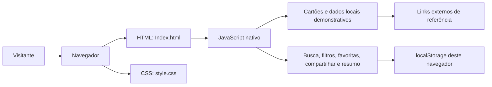
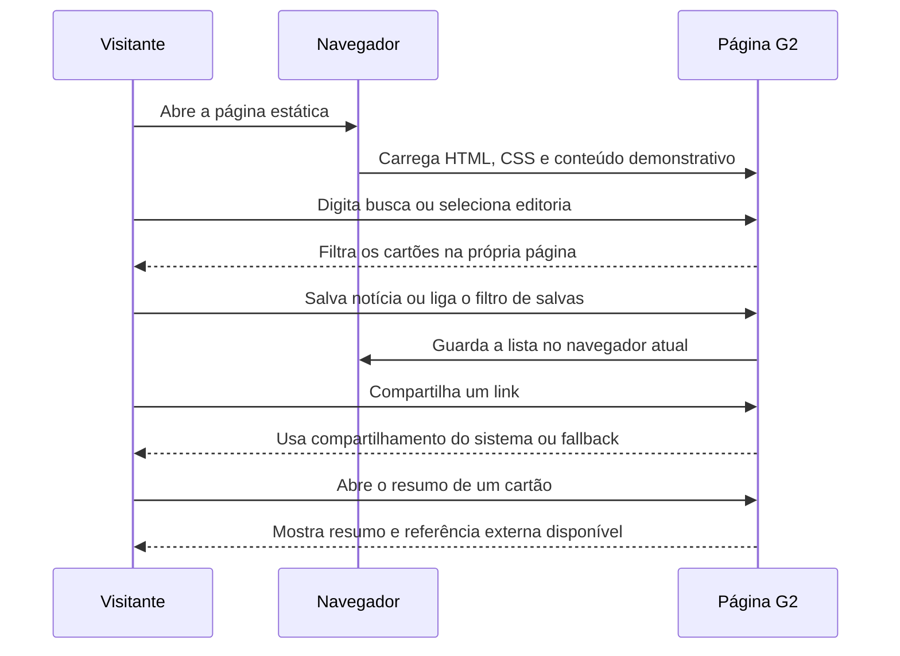

# G2 Notícias — continuidade do projeto

Projeto acadêmico estático inspirado em portais de notícias. O escopo atual usa HTML, CSS e JavaScript nativos e mantém o conteúdo demonstrativo; não há API, servidor de aplicação ou banco de dados.

## Inventário atual

| Área | Ferramentas e arquivos | Observações |
|---|---|---|
| Interface | HTML5 em `CORPOSITE/Index.html` | Página única, sem framework ou roteador |
| Estilos | CSS3 em `CORPOSITE/style.css` | Grid responsivo e cores em variáveis CSS |
| Interações | JavaScript nativo em `CORPOSITE/script.js` | Busca, filtro, painel de resumo, favoritas locais, compartilhar e voltar ao topo |
| Conteúdo | Dados e links embutidos no HTML | Notícias demonstrativas; imagens externas do Unsplash |
| Dependências/build | Nenhuma dependência de execução; `@playwright/test` é dependência exclusiva de desenvolvimento | Sem framework ou etapa de build; testes e servidor local usam pacote de teste e módulos nativos do Node.js |

## O que foi continuado

- Adicionadas editorias de Ciência e Saúde e uma seção demonstrativa de Guia de Compras (Casa, Celulares, Moda e Beleza).
- Busca e filtro por editoria também incluem as novas seções.
- O menu de editorias usa botão nativo com estado ARIA, teclado e links móveis expansíveis.
- A grade usa colunas adaptáveis ao espaço, melhora a apresentação quando uma editoria tem poucos cartões e evita manter colunas vazias.
- As novas imagens têm texto alternativo, dimensões reservadas e carregamento tardio. O conteúdo de guia identifica que preços/produtos não são atualizados ao vivo.
- Incluída uma curadoria manual com três matérias da Agência Brasil consultadas em 20/10/2026, com veículo, editoria, data/hora e link original. Os cartões abrem diretamente a fonte.
- A seção da curadoria agora se chama “Destaques da Agência Brasil” e informa que a data é da consulta editorial; o cartão principal recebe hierarquia visual própria.
- Link para a página oficial de RSS da Agência Brasil e aviso visível de que a curadoria da página não se atualiza automaticamente. Os cartões antigos estão identificados como material demonstrativo.
- Interações visuais coerentes: hover sutil nos cartões sem zoom de imagem, resposta tátil nos botões, indicador animado na navegação e entradas leves para menu, resumo e avisos. Foco visível e respeito a `prefers-reduced-motion`.
- Adicionados salvar/remover favoritas (persistência no navegador), filtro para mostrar apenas favoritas, compartilhar via Web Share API com fallback, e retorno ao topo.
- Links de editoria atualizam o estado ativo pela navegação e rolagem; o menu móvel fecha após a seleção e por Escape.
- Resumos são derivados do cartão acionado, anunciam seu título, permitem Escape e devolvem o foco ao controle de origem.
- As ações demonstrativas usam o rótulo “Ver resumo” e não duplicam o botão de resumo criado pelo JavaScript. O primeiro cartão curado tem um identificador editorial coerente; favoritas gravadas com o ID anterior migram automaticamente.
- Busca ignora diferenças de acentuação; favoritas usam IDs estáveis, descartam IDs obsoletos e continuam operáveis se o armazenamento falhar.
- Imagens dos cartões têm dimensões reservadas, carregamento tardio e alternativa visual quando a imagem remota falha.
- Resultados exibem contagem; busca vazia e favoritas vazias têm mensagens próprias e ações para recuperar a navegação.
- Favoritas e compartilhamento dão feedback visual que também é anunciado pela região acessível da página; o aviso pode ser dispensado.
- Quando Web Share e clipboard não estão disponíveis, o link fica visível em um campo selecionável para cópia manual.
- O painel de resumo expõe `aria-expanded` e `aria-controls` no acionador e identifica a região aberta; Escape e o botão de fechar devolvem o foco.
- Incluído link para pular ao conteúdo, metadados Open Graph básicos e estilos dedicados ao painel de resumo.

## Diagnóstico e benchmarking

Antes das alterações havia dois arquivos de aplicação, histórico Git com versão inicial e uma versão subsequente, e nenhum framework, API, backend, base de dados, pacote ou etapa de build. A página mantinha busca, filtro e resumo dos cartões, mas o CSS do menu móvel não tinha o controle HTML correspondente; manchetes demonstrativas apareciam junto a conteúdo com aparência factual; havia transições sem tratamento de movimento reduzido. Essas funções e estilos foram preservados e estendidos.

Benchmark consultado: a Agência Brasil organiza um feed RSS por editoria e publica data/hora em suas notícias; a BBC disponibiliza orientação de acessibilidade para produtos digitais; a Reuters agrupa conteúdo por códigos de editoria/região. Aplicamos os princípios de editorias explícitas, proveniência e metadados legíveis, sem copiar marca ou layout. A Agência Brasil autoriza reprodução jornalística com crédito, mas alerta que conteúdo de agências parceiras pode ter restrições; por isso este projeto usa links e resumos factuais concisos, sem copiar imagens ou artigos completos.

Referências consultadas: [RSS da Agência Brasil](https://agenciabrasil.ebc.com.br/feed/), [política editorial e de reprodução da Agência Brasil](https://agenciabrasil.ebc.com.br/sobre), [serviço de notícias em tempo real da EBC](https://www.gov.br/pt-br/servicos/acessar-noticias-em-tempo-real-gratuitamente?id=10223&origem=servico), [BBC Accessibility Help](https://help.bbc.com/hc/en-us/articles/42403617398163-BBC-Accessibility-Help), [Reuters Topic Codes](https://liaison.thomsonreuters.com/tools/topic-codes).

Matérias verificadas para a curadoria de 20/10/2026: [Justiça torna ré PM por homicídio de mulher na Zona Leste de SP](https://agenciabrasil.ebc.com.br/justica/noticia/2026-10/justica-torna-re-pm-por-homicidio-de-mulher-na-zona-leste-de-sp) (14h40), [Governo impõe emergência zoossanitária após detectar Newcastle em SC](https://agenciabrasil.ebc.com.br/saude/noticia/2026-10/governo-impoe-emergencia-zoossanitaria-apos-detectar-newcastle-em-sc) (12h52), [Cena Musical celebra Roberto Menescal](https://agenciabrasil.ebc.com.br/cultura/noticia/2026-10/cena-musical-da-tv-brasil-celebra-vida-e-obra-de-roberto-menescal) (08h30).

Limite atual: RSS oficial existe, mas não há API/backend e o carregamento direto de XML pelo navegador não foi validado quanto a CORS nem foi testado no browser. Para atualização automatizada, a próxima etapa deve buscar/normalizar o RSS do lado servidor, respeitar avisos de direitos por item, cachear e exibir o horário da última atualização. O arquivo estático não faz polling e não expõe credenciais.

As favoritas ficam no `localStorage` deste perfil de navegador: não sincronizam entre dispositivos e podem ser apagadas ao limpar os dados do navegador. Sem suporte a armazenamento local, a interface continua funcionando, mas não conserva as favoritas após fechar a sessão. Compartilhar usa a Web Share API quando disponível; senão, tenta copiar o link e, se não houver nenhuma das duas APIs, mostra o link em um campo selecionável para cópia manual.

## Plano de evolução e critérios de aceite

| Marco | Tarefas e aceite | Esforço | Dependência |
|---|---|---:|---|
| 1. Conteúdo e navegação | Completar Ciência, Saúde e Guia de Compras; links de menu e filtro levam às seções certas | Feito nesta entrega | — |
| 2. Qualidade editorial | Revisar cada notícia e registrar fonte, data e link direto; não apresentar textos de exemplo como notícia verificada | 3–5 h | Definição editorial |
| 3. Acessibilidade e SEO | Navegação por teclado, foco visível, títulos/descrições únicos por página; auditoria WCAG 2.2 AA sem erros críticos | 4–6 h | Marco 2 |
| 4. Desempenho | Otimizar imagens locais, dimensionar todos os espaços de mídia e medir LCP ≤2,5 s, INP <200 ms e CLS <0,1 em dados de campo ou auditoria documentada | 3–5 h | Hospedagem definida |
| 5. Validação | Automatizar busca, filtro, menu e resumo; registrar resultados de acessibilidade e Lighthouse | 4–8 h | Definir ferramenta de testes |
| 6. Publicação | Hospedar os arquivos estáticos; configurar domínio e, com o domínio definido, robots.txt e sitemap.xml válidos | 2–4 h | Provedor/domínio |

Estimativas são horas de desenvolvimento, não prazos de calendário. Responsável sugerido: equipe do projeto. Datas devem ser combinadas com o calendário acadêmico; não foram inventadas datas de entrega.

## Arquitetura e fluxo atuais

O projeto não possui back-end nem banco. O navegador lê os arquivos estáticos e os dados de demonstração; os links de fonte abrem páginas externas.





## Ferramentas e alternativas

| Atual | Versão/uso | Alternativas possíveis | Avaliação |
|---|---|---|---|
| HTML/CSS/JavaScript nativos | Sem dependências | React ou Vue | Atual é suficiente para página pequena; framework acrescenta build e manutenção, justificável se houver muitas rotas/componentes dinâmicos |
| CSS Grid e media queries | CSS nativo | Bootstrap ou Tailwind CSS | Mantém o estilo atual sem dependência; frameworks podem acelerar uma expansão, mas implicam adoção e configuração |
| Conteúdo estático | Arquivos locais e referências externas | CMS/API e banco relacional | Dados estáticos mantêm implantação simples; CMS/API só se justificam com publicação frequente ou vários editores |

Não há substituição recomendada nesta etapa. Antes de adotar versões de frameworks, validar compatibilidade com a hospedagem e necessidade real do projeto.

## Estrutura e operação

```text
SITENOTICIASG2/
├── README.md
└── CORPOSITE/
    ├── Index.html
    ├── script.js
    └── style.css
```

Para visualizar por HTTP durante desenvolvimento, execute `npm run serve` na raiz do projeto e acesse `http://127.0.0.1:4173/Index.html`. O servidor de desenvolvimento usa apenas módulos nativos do Node.js. Para publicar, envie `Index.html`, `style.css` e `script.js` juntos, preservando os caminhos relativos. Não existe etapa de compilação ou comando de deploy configurado. Canonical, sitemap e robots dependem da definição de domínio e plataforma reais.

## Exemplos e validação

Exemplo de cartão sem framework, seguindo a marcação usada pela página:

```html
<article class="news-card" data-categoria="Ciência">
  
  <div class="conteudo">
    <span class="categoria">Ciência</span>
    <h3>Título da notícia</h3>
    <p>Resumo com contexto e fonte identificada.</p>
    <a class="botao" href="URL-DA-FONTE">Ler matéria</a>
  </div>
</article>
```

Casos automatizados definidos em `tests/news-portal.spec.js` usando Playwright; instale as dependências de desenvolvimento e os navegadores Playwright antes de executá-los:

```sh
npm install
npx playwright install chromium
npm test
```

O teste inicia servidor HTTP local pelo `playwright.config.js`.

| Caso | Ação | Resultado esperado |
|---|---|---|
| Navegação móvel | Abrir/fechar Editorias e ativar cada link | Menu visível/oculto e seção correspondente alcançada |
| Busca | Digitar termo presente, ausente e sem acento | Cartões correspondentes filtrados; contagem visível, equivalência de acentos e ação para limpar filtros no estado vazio |
| Filtro | Selecionar Ciência ou Guia de Compras | Apenas cartões da categoria selecionada permanecem visíveis; resumo aberto persiste se o cartão continuar visível |
| Resumo | Abrir e fechar resumo por botão/Escape | Título e texto correspondem ao cartão; fonte externa aparece quando o cartão tem URL; foco retorna ao acionador |
| Favoritas | Salvar notícia, recarregar e filtrar Salvas; abrir filtro sem favoritas | Estado persiste neste navegador; filtro exibe só as salvas e oferece retorno quando vazio; ações mostram feedback |
| Compartilhar | Acionar com Web Share, clipboard e sem suporte às APIs | Compartilha ou copia link; se as APIs faltarem, deixa o link selecionável; cancelamento não gera erro |
| Voltar ao topo | Rolar além do limite e acionar o controle | Botão aparece após rolagem e retorna ao início |
| Teclado | Navegar por menu, busca e ações usando Tab/Enter/Espaço | Todos os controles alcançáveis e operáveis, com foco visível |

Registro de validação manual em 21/10/2026: os arquivos `Index.html`, `style.css` e `script.js` responderam por HTTP local com status 200. No navegador integrado, foram exercitados o estado de busca sem resultados (texto específico, contagem e ação visíveis), limpeza dos filtros com foco devolvido à busca, estado vazio de favoritas, retorno à lista, acionamento do resumo, estado ARIA, fechamento pelo botão e retorno do foco, além de feedback visual ao salvar e dispensar aviso com retorno do foco. O menu móvel foi revalidado por abertura, Escape e retorno do foco. As larguras 320, 390, 768 e 1024 px foram verificadas após estas mudanças; a página não ultrapassou a largura do viewport, e o aviso coube com margens laterais em 320 px. Busca sem acento, filtro por editoria, favoritas com persistência após recarga, âncoras e retorno ao topo haviam sido exercitados anteriormente. Não houve overflow horizontal nos viewports medidos anteriormente (320, 360, 390, 600, 602, 768, 850, 1024 e 1440 px).

A suíte Playwright foi ampliada com os estados vazios, contagem, restauração de foco, estado ARIA do resumo, aviso visual, armazenamento indisponível e fallback de compartilhamento sem as APIs. Ela não foi executada porque `npm` não está disponível neste ambiente; as asserções adicionadas ainda precisam ser rodadas após instalar as dependências de desenvolvimento e o navegador Playwright. Também não foram exercitados os ramos de Web Share/clipboard, falha de armazenamento local, leitor de tela ou preferência de movimento reduzido nesta validação manual. `node --check` passou para `script.js` e `news-portal.spec.js`, e `git diff --check` passou. Não afirmamos conformidade WCAG nem resultado Lighthouse sem essas medições.

## Próximas melhorias compatíveis

1. Definir a cadência da curadoria manual e atualizar sua data visível a cada revisão; a seção agora é identificada como “Destaques da Agência Brasil”.
2. Definir domínio e hospedagem antes de canonical, sitemap.xml ou robots.txt.
3. Avaliar hospedagem local/otimização das imagens após medir desempenho; as imagens ainda dependem de Unsplash.
4. Fazer auditoria manual com teclado e leitor de tela, além de medir contraste e Lighthouse, antes de qualquer alegação WCAG ou de desempenho.
